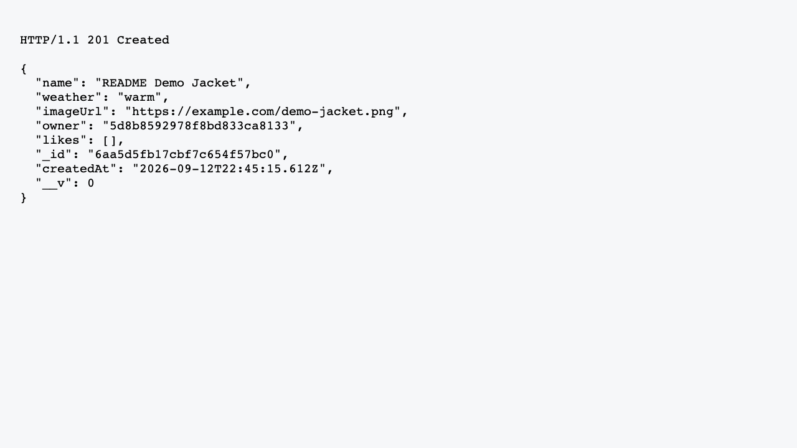
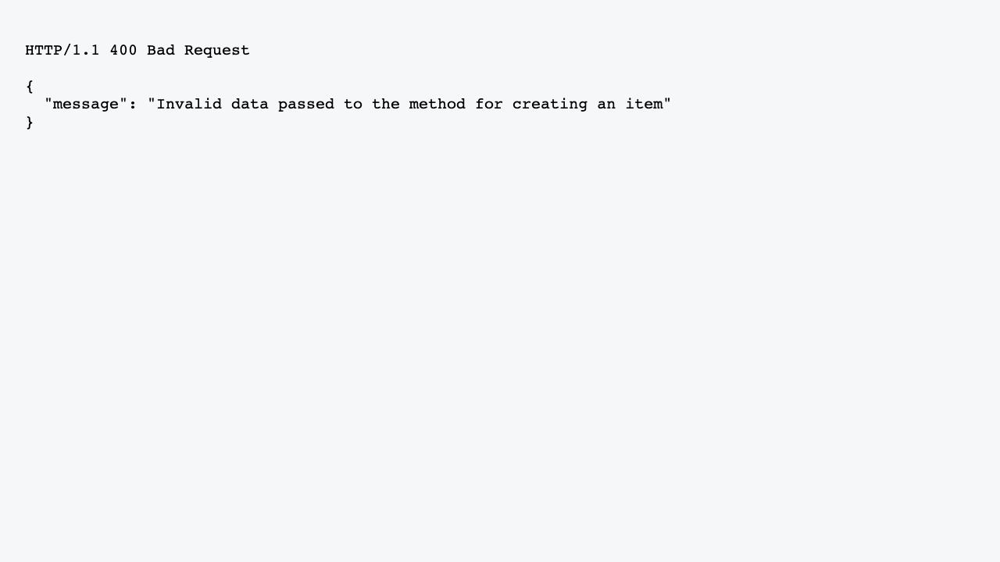

# WTWR (What to Wear?): Back End

This project provides the back-end API for the WTWR weather-based clothing application. It stores users and clothing items in MongoDB and exposes endpoints for creating, viewing, deleting, liking, and unliking clothing items.

## Technologies

- Node.js and Express
- MongoDB with Mongoose
- Validator for URL validation
- ESLint with the Airbnb base configuration
- Nodemon for local development

## Screenshots

Successful item creation:



Validation error response:



## Getting Started

Install the project dependencies:

```bash
npm install
```

Start MongoDB with Docker:

```bash
docker compose up -d mongo
```

Start the API on `http://localhost:3001`:

```bash
npm run start
```

For development with hot reload:

```bash
npm run dev
```

Run the linter:

```bash
npm run lint
```

## API Endpoints

### Users

- `GET /users` — get all users
- `GET /users/:userId` — get one user
- `POST /users` — create a user with `name` and `avatar`

### Clothing Items

- `GET /items` — get all clothing items
- `POST /items` — create an item with `name`, `weather`, and `imageUrl`
- `DELETE /items/:itemId` — delete an item
- `PUT /items/:itemId/likes` — like an item
- `DELETE /items/:itemId/likes` — unlike an item

The API connects to `mongodb://localhost:27017/wtwr_db`. Validation and request errors return JSON responses with a `message` field.
