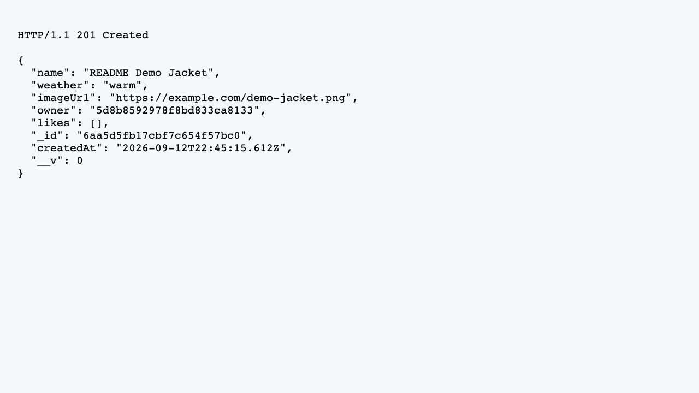
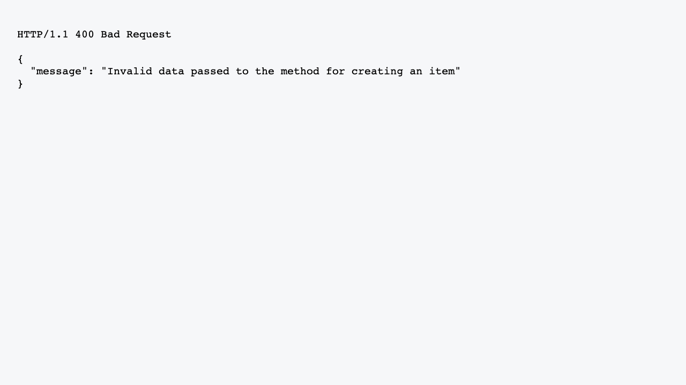

# WTWR (What to Wear?): Back End

This project provides the back-end API for the WTWR weather-based clothing application. It stores users and clothing items in MongoDB, supports account registration and sign-in with JWT authorization, and exposes endpoints for managing profiles and clothing items.

## Technologies

- Node.js and Express
- MongoDB with Mongoose
- Celebrate, Joi, and Validator for request and model validation
- Winston for request and error logging
- bcryptjs for password hashing
- JSON Web Tokens for authentication
- CORS for cross-origin requests
- ESLint with the Airbnb base configuration
- Nodemon for local development

## Deployed Application

- Frontend: [WTWR](https://wtwr-gabriel.host2go.net)
- API: [api.wtwr-gabriel.host2go.net](https://api.wtwr-gabriel.host2go.net)

## Front End

The React application is available in the [WTWR frontend repository](https://github.com/gromero-ca/se_project_react).

## Project Pitch Video

Watch [WTWR Project Pitch - Gabriel Romero](https://drive.google.com/file/d/1_Wbd_Vhc8GmrwxpUsNToBX7m2Xa7sIrr/view?usp=sharing), where I explain WTWR and the challenges I faced while building the backend.

## Screenshots

Successful item creation:



Validation error response:



## Getting Started

Install the project dependencies:

```bash
npm install
```

Start MongoDB with Docker:

```bash
docker compose up -d mongo
```

Start the API on `http://localhost:3001`:

```bash
npm run start
```

For development with hot reload:

```bash
npm run dev
```

Run the linter:

```bash
npm run lint
```

Run the automated checks:

```bash
npm test
```

## API Endpoints

### Users

- `POST /signup` — create an account with `name`, `avatar`, `email`, and `password`
- `POST /signin` — sign in with `email` and `password`; the response contains a JWT
- `GET /users/me` — get the authenticated user's profile
- `PATCH /users/me` — update the authenticated user's `name` and/or `avatar`

### Clothing Items

- `GET /items` — get all clothing items (public)
- `POST /items` — create an item with `name`, `weather`, and `imageUrl`
- `DELETE /items/:itemId` — delete an item you own
- `PUT /items/:itemId/likes` — like an item
- `DELETE /items/:itemId/likes` — unlike an item

All routes except `POST /signup`, `POST /signin`, and `GET /items` require an `Authorization: Bearer <token>` header. Set `JWT_SECRET` in the environment to override the development signing key; production requires this variable. The API connects to `mongodb://localhost:27017/wtwr_db`. Validation and request errors return JSON responses with a `message` field.

For production, configure `NODE_ENV=production` and `JWT_SECRET` in an untracked `.env` file on the server. Requests and errors are written to `request.log` and `error.log`; these files are ignored by Git. The temporary `/crash-test` endpoint is required for the Project 15 review and must be removed after approval.

Signup and signin share a limit of 50 requests per client IP every 15 minutes. Signin also allows at most 10 failed attempts per account in that period. Account limits group email case and surrounding whitespace without changing the credentials used to sign in. Limited requests return status `429`, a JSON `message`, and a `Retry-After` header. Counters are held in memory for the current single-process deployment and reset when the process restarts.

Only loopback reverse proxies are trusted. Keep Node bound to `127.0.0.1` and configure Nginx to append or overwrite `X-Forwarded-For` with the actual client address. The development Docker database is likewise bound to `127.0.0.1`.
